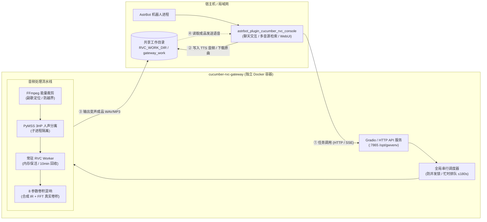

# cucumber-rvc-gateway · RVC 控制台推理网关

<div align="center">

**AstrBot 插件「RVC 控制台」专属的高性能独立推理与音频处理网关**

[-brightgreen.svg?style=flat-square&logo=docker)](https://github.com/AkinoSa/cucumber-rvc-gateway/pkgs/container/cucumber-rvc-gateway)
[]()
[](LICENSE)
[](https://github.com/AkinoSa/astrbot_plugin_cucumber_rvc_console)
[]()

取音源 → 严格时间校验 → FFmpeg 副歌裁剪 → 3HP 人声分离(PyMSS) → RVC 音色转换 → 8 参数卷积混响 → 输出成品音频  
内置高并发防爆全局串行调度、常驻内存模型 Worker、TTS 快速变声接口与完整自动化健康诊断


</div>

> [!NOTE]
> 本项目为纯推理与音频处理后端，**不直接对接聊天平台**。  
> 请配合聊天交互端插件 **[astrbot_plugin_cucumber_rvc_console · RVC 控制台](https://github.com/AkinoSa/astrbot_plugin_cucumber_rvc_console)** 协同使用。  
> 插件负责搜歌、聊天交互、LLM 人格拟人回复与 WebUI 任务管理；网关负责所有重 CPU 推理计算，两者通过 Docker 与 HTTP/SSE 完全解耦。

---

## 🏗️ 系统协同架构



### 核心设计原则
1. **纯 CPU 推理极致优化**：专为无独立显卡的家用 NAS、小主机及 Linux 服务器调优（实测 Intel i5-6500 稳定流畅），无需昂贵 GPU；
2. **全局串行防并发锁**：RVC 与 3HP 人声分离峰值内存约 2.5GB~4GB，网关采用全局串行排队机制，彻底杜绝多任务并发导致的系统卡死或 OOM Crash；
3. **常驻 Worker 极速变声**：`rvc_worker.py` 在常驻进程中保持音色模型常驻内存，免除每次翻唱或 TTS 变声耗时 ~40s 的模型重复加载开销（空闲 10 分钟自动释放释放内存）；
4. **模型解耦与动态热更**：所有模型权重以只读卷挂载，新增 `.pth` 音色模型即放即用，无需重建镜像或重启容器。

---

## 🖥️ 运行环境要求

| 项目 | 最低要求 | 推荐配置 / 实测验证 |
|---|---|---|
| **操作系统** | Linux x86_64（内核 ≥ 5.10） | **飞牛 fnOS**、Debian 12、Ubuntu 22.04+ |
| **容器引擎** | Docker 20.10+ & Docker Compose v2 | 支持 Compose 资源限制与健康检查 |
| **CPU 处理器** | 4 核 x86_64 处理器 | 实测 Intel Core i5-6500 (4C4T) 及以上 |
| **运行内存 (RAM)** | 8GB 物理内存 | **推荐 16GB**（容器 `mem_limit` 建议设为 12GB） |
| **GPU 显卡** | **无需独立显卡** | 纯 CPU 推理，开箱即用 |

---

## 🚀 极速部署指南

### 方式一：使用 GHCR 预构建镜像（推荐，开箱即用）

官方已将多阶段构建的完整运行镜像发布至 GitHub Container Registry（GHCR），无需自行花费十几分钟拉取依赖编译：

1. **克隆项目并准备配置文件**：
   ```bash
   git clone https://github.com/AkinoSa/cucumber-rvc-gateway.git
   cd cucumber-rvc-gateway
   cp .env.example .env
   ```

2. **编辑 `.env` 配置文件**：
   根据你宿主机的真实绝对路径填写各项模型目录与工作区（详细字段见下方「.env 说明」）：
   ```bash
   nano .env
   ```

3. **拉取镜像并启动**：
   ```bash
   docker compose pull
   docker compose up -d
   ```

4. **自检启动状态**：
   ```bash
   # 查看实时运行日志与启动自检报告
   docker logs -f cucumber-rvc-gateway
   
   # 测试网关健康检查端点
   curl http://127.0.0.1:3333/
   # 返回页面即表示网关启动成功！
   ```

---

### 方式二：从源码自行构建（进阶开发者）

如需二次开发或修改底层算法：

```bash
# 修改 compose.yaml，取消 build: . 的注释并注释 image: 行
docker compose up -d --build
```

---

## 📂 宿主机模型目录准备

网关镜像内部不包含庞大的模型权重文件，请在宿主机准备一个目录（例如 `/vol1/1000/ai/rvc/`），按如下结构放置：

```text
/vol1/1000/ai/rvc/
├── weights/           # 【必填】你的 RVC 音色模型文件 (*.pth)
│   ├── deng.pth
│   └── nuoyemu.pth
├── indices/           # 【可选】对应音色的检索特征文件 (*.index，按同名自动匹配)
│   └── added_IVF1024_Flat_nprobe_1_deng_v2.index
├── pymss_weights/     # 【必填】3HP 人声伴奏分离模型文件
│   └── 3_HP-Vocal-UVR.pth
├── hubert_base/       # 【必填】HuBERT 基础声学特征提取模型
│   └── hubert_base.pt
└── rmvpe/             # 【必填】RMVPE 高精度音高提取模型
    └── rmvpe.pt
```

> [!TIP]
> **关于音色动态发现**：只要将新的 `.pth` 模型放入 `weights/` 目录，在 QQ 群发送 `/刷新rvc模型` 或在 WebUI 刷新，网关即时感知并加载，**无需重启 Docker 容器**。

---

## ⚙️ 配置文件说明 (.env)

| 配置变量名 | 必填 | 默认建议值 | 核心说明 |
|---|---|---|---|
| `RVC_GATEWAY_PORT` | 否 | `3333` | 网关在宿主机对外暴露的 HTTP 访问端口 |
| `MEM_LIMIT` | 否 | `12g` | 容器内存使用硬上限（防止异常情况撑爆宿主机物理内存） |
| `RVC_OMP_THREADS` | 否 | `2` | PyTorch CPU 推理线程数（推荐 2；线程过高易引发上下文争抢与 OOM） |
| `RVC_WEIGHTS_DIR` | **是** | 宿主机路径 | 映射到容器内 `/app/assets/weights`，只读 |
| `RVC_INDICES_DIR` | **是** | 宿主机路径 | 映射到容器内 `/app/assets/indices`，只读 |
| `RVC_PYMSS_WEIGHTS_DIR` | **是** | 宿主机路径 | 映射到容器内 `/app/assets/pymss_weights`，只读 |
| `RVC_HUBERT_DIR` | **是** | 宿主机路径 | 映射到容器内 `/app/assets/hubert_base`，只读 |
| `RVC_RMVPE_DIR` | **是** | 宿主机路径 | 映射到容器内 `/app/assets/rmvpe`，只读 |
| `RVC_WORK_DIR` | **是** | 宿主机路径 | **核心读写工作区**。包含 cache/out/logs/tts，**必须与插件配置中的 `gateway_work_dir` 填完全相同的路径** |
| `RVC_PLUGIN_DATA_DIR` | **是** | 宿主机路径 | AstrBot 宿主机 `data/plugin_data` 路径，使网关能直接读取插件下载的音频 |
| `RVC_SEP_MODEL` | 否 | `3_HP-Vocal-UVR.pth` | 默认使用的人声分离模型文件名 |
| `RVC_MAX_CLIP_SECONDS` | 否 | `30` | 翻唱副歌最大裁切时长（秒） |

---

## 🔗 与 AstrBot 插件联动配置

启动好网关后，在 **AstrBot WebUI → 插件配置 → RVC 控制台** 中填入以下两项即可连通：

1. **网关服务地址 (`rvc_base_url`)**：
   - 同一主机：`http://127.0.0.1:3333/`（末尾必须带 `/`）；
   - 跨容器或跨机器：`http://<宿主机局域网IP>:3333/`。
2. **网关工作目录 (`gateway_work_dir`)**：
   - 填写与 `.env` 中 `RVC_WORK_DIR` **完全一致的宿主机绝对路径**。  
   > 为什么需要一致？网关在处理完变声后，返回音频文件路径，AstrBot 需要通过宿主机文件系统直接读取并转换为群语音发送。

---

## 📡 API 端点规范 (Gradio 6 Endpoints)

网关基于 Gradio 6.31 提供了标准的 SSE/HTTP 命名 API，支持无缝远程调用：

| 端点 (Endpoint) | 说明 | 输入参数要点 |
|---|---|---|
| `/convert` | 完整歌曲翻唱流水线 | 取源 → 严格时间校验 → 裁剪 → 人声分离 → RVC 变声 → 淡入淡出 → 卷积混响 |
| `/tts_convert` | TTS 音频变声 | 针对短音频（≤60s）快速换声，输入限制在白名单目录内，支持独立音色与混响 |
| `/model_info` | 动态音色与 Index 检查 | 返回当前已挂载的所有音色列表、模型状态与同名 index 匹配情况 |
| `/show_model` | 音色轻量列表查询 | 返回格式化音色下拉候选项 |
| `/separate` | 单独人声分离 | 仅提取伴奏与人声干音，用于试听与提取素材 |
| `/clip` | 单独音频裁切 | 仅执行基于能量吸附算法的高潮片段裁剪 |
| `/cache_info` / `/clear_cache` | 缓存管理 | 查询或清空生成的历史切片中间文件 |

---

## 📊 性能实测基准 (CPU Benchmark)

测试机型：家用低功耗主机（飞牛 fnOS / Intel Core i5-6500 4C4T / 16GB DDR4 / 纯 CPU）

| 处理步骤 | 典型耗时 (30s 歌曲切片) | 资源占用状态 |
|---|---|---|
| **音频裁剪与校验** | ~ 0.5 秒 | 瞬时微秒级完成 |
| **PyMSS 3HP 人声分离** | ~ 60 ~ 70 秒 | CPU 满载，内存约 2.2GB |
| **RVC 音色转换 (热态)** | ~ 45 ~ 55 秒 | 常驻 Worker 内存命中，零加载延迟 |
| **卷积混响润色** | ~ 0.2 秒 | 瞬时完成 |
| **整体翻唱流程** | **约 2 分钟左右** | 全局串行锁保护，系统整体平稳运行 |
| **TTS 短语音变声** | **约 10 ~ 15 秒** | 短句即时响应 |

---

## ❓ 常见问题排查 (FAQ)

<details>
<summary><b>1. 容器启动后秒退，日志提示「启动检查失败」？</b></summary>

网关在启动阶段会自动执行 `_validate_startup_paths()` 严格自检：
1. 检查 `.env` 中配置的目录是否在宿主机上真实存在；
2. 检查 `pymss_weights`、`hubert_base`、`rmvpe` 目录中是否已放入对应的 `.pth` / `.pt` 模型文件；
3. 查看具体报错日志：`docker logs cucumber-rvc-gateway`，按缺失项补充文件即可。
</details>

<details>
<summary><b>2. 翻唱任务提示「已有推理任务在执行且等待超时」？</b></summary>

为了保护 NAS/CPU 不被压垮，网关设置了单一推理锁（等待上限 180s）。若前序任务耗时超过 180 秒（如提交了极长的整首无损音频），后序任务会自动安全超时放弃。可缩短翻唱片段长度或等待前序任务结束。
</details>

<details>
<summary><b>3. 容器退出码为 -9？</b></summary>

退出码 `-9` 代表进程被 Linux 内核 OOM Killer 强制终止。请检查宿主机可用内存，建议物理内存 ≥ 16GB，并将 `.env` 中的 `MEM_LIMIT` 设置为 `12g`。
</details>

<details>
<summary><b>4. AstrBot 报错「无法读取输出音频文件」？</b></summary>

请确保网关 `.env` 中的 `RVC_WORK_DIR` 与 AstrBot 插件设置中的 `gateway_work_dir` 填写的是**同一绝对路径**。因为网关输出的文件保存在该目录下，插件必须能够直接通过宿主机文件系统读取到它。
</details>

---

## 🤝 开源协议与鸣谢

- 本项目基于 **GNU AGPL-3.0** 协议发布，与配套插件 [astrbot_plugin_cucumber_rvc_console](https://github.com/AkinoSa/astrbot_plugin_cucumber_rvc_console) 享有相同的开源协议；
- 推理底层源自 [RVC-Project/Retrieval-based-Voice-Conversion-WebUI](https://github.com/RVC-Project/Retrieval-based-Voice-Conversion-WebUI)（MIT License）；
- 人声伴奏分离基于 [PyMSS](https://github.com/KitsuneX07/subpixel) 系 3HP 模型（MIT License）；
- 感谢 [AstrBot](https://github.com/AstrBotDevs/AstrBot) 团队提供出色的聊天机器人基础设施。
